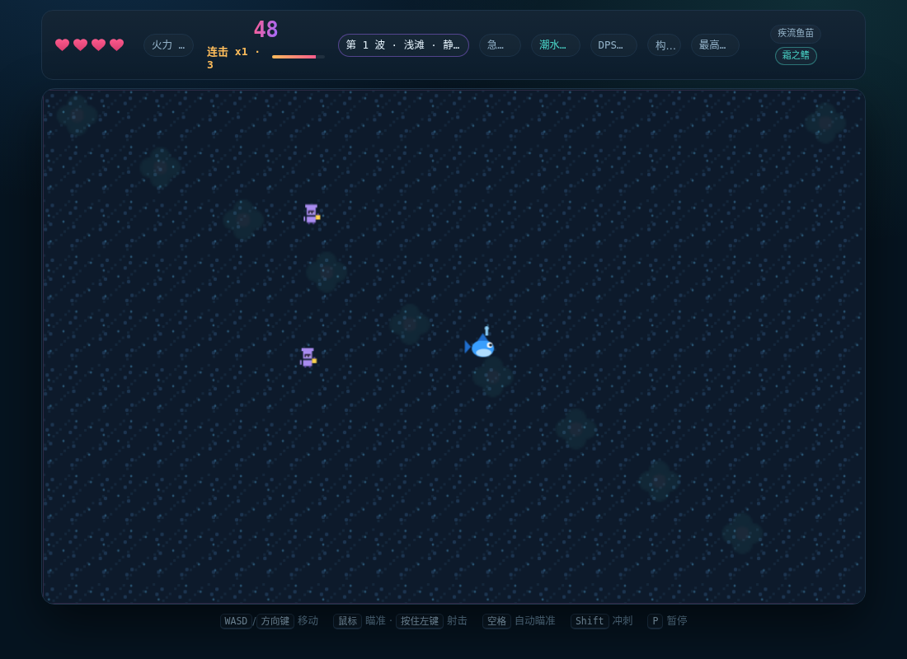
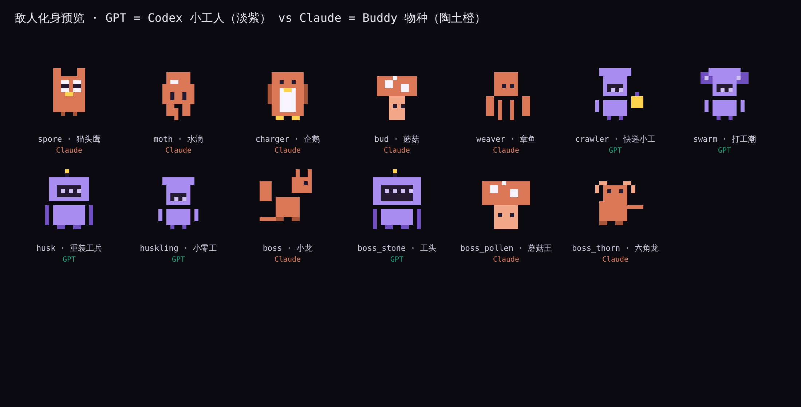

# 大肥鱼历险记 · Big Fat Fish

> **V2 已有独立战斗试作**：运行 `npm run dev` 后打开 `/v2.html`。键鼠/手机双摇杆，两把MCP、两个技能、棕蟹/Bot、暂停和检查点保存/继续。
> [实际进度与剩余任务](docs/design-v2/13-development-status.md) · [玩法规格](docs/design-v2/00-README.md) · [架构](docs/design-v2/11-architecture-contracts.md) · [函数目录](docs/design-v2/12-function-catalog.md)。当前178个函数有实现，142个TODO，Free与Pro1 Claude短途已可操作，支持信标/追兵/首领/正式结算；完整游戏仍在开发。
> 以下玩法介绍仍描述旧版 `index.html`。

> 纯代码生成的 2D 肉鸽生存射击。**零美术素材、零音频素材、零外部依赖** ——
> 所有图形由 Phaser Graphics 在运行时生成，所有音效用 WebAudio 振荡器合成，
> 仓库里没有一张图片、一个音频文件。



**你是深海里的一条大肥鱼。** 出水面的怪物不是鱼 —— 是 **GPT** 与 **Claude** 的化身。



| 阵营 | 形象 | 颜色 | 成员 |
|---|---|---|---|
| **GPT** | 六瓣结（OpenAI "Blossom"：六向旋转对称、六个圆环交织） | 青绿 `#10A37F` | 贪嘴小鱼 / 沙丁鱼群 / 海葵 / 铁壳蟹 / 蟹壳碎屑 |
| **Claude** | 手绘星芒（Anthropic 放射笔画：长短不一、略带回弧、收笔不匀） | 陶土橙 `#D97757` | 水母 / 毒水母 / 墨鱼 / 旗鱼 |
| **合体** | 结 + 芒叠在一起 | 两色 | 深渊巨鲸（终局 Boss） |

---

## 跑起来

```bash
npm install
npm run dev        # 开发服务器
npm test           # 单元测试（350 项 / 25 个文件）
npm run build      # 产出 dist/
node scripts/playtest.mjs        # 真 Chromium 跑一遍完整流程（134 项）
node scripts/avatar-preview.mjs  # 敌人化身预览图
```

产物是 `dist/`，也可以直接用 `index.html` + `npm run dev`。
**没有构建步骤也能玩** —— 所有美术都是运行时画的。

---

## 玩法

- **4 章 × 5 波 = 20 波主线** + 终局 Boss（第 20 波）+ 可续无尽模式
- **每章**：二选一**路线** → 三选一**装备** → 五波 → 章末**休整**（二选一）= **16 个决策点**
- 15 种章内主题、6 条路线、44 件装备、4 个流派、5 个可选角色
- 9 种敌种 + 5 种精英词缀 + 每章不同 Boss
- `?seed=` 可复现种子；每日挑战；局外解锁（深海藏品）
- **对症机制**（本项目的核心）：克制**不是提示，是真机制** ——
  伤害 ×2.5，倍率曲线是**凸**的（凑齐手段远比单张值钱），
  四种手段的命中集合互不重叠，**深化也能给手段**（抽不到对症牌时有唯一出口）。

> 想知道机制是怎么被一步步逼出来的、被推翻过几次、每条结论的实测数字在哪，
> 看 **[`DECISIONS.md`](DECISIONS.md)**（27 节，含 6+ 条被自己推翻的方案）。
> 敌人化身那一轮单独记在 **[`DECISIONS-AVATARS.md`](DECISIONS-AVATARS.md)**。

---

## 工程约定（这个仓库为什么长这样）

- **零素材**是硬约束：所有图形运行时生成 ⇒ 改一行参数就能换皮，不用美术资源。
- **纯逻辑层不 import Phaser、不碰 DOM** ⇒ 逻辑可以单测、可以离屏渲染。
  `src/art/avatars.js`（敌人化身）与 `src/art/graphics-probe.js`（离屏 SVG 渲染器）是这个约定的样板。
- **只改画，不改机制**：换皮永远不动 id、碰撞半径、数值、弱点表。
- **视觉大小 == 碰撞大小**：化身绘制函数的 `r` 定义为**外接半径**，
  调用方直接传碰撞半径 ⇒ 玩家不会遇到「看着没打中却被打死了」。
  （这条由 `tests/avatars.test.js` 钉住。）
- **同一件事只有一份实现**：期望 DPS 只在 `systems/upgrades.js` 的 `expectedDps()` 一处，
  覆盖度、抽卡估值、机器人评分共用它。
- **对照实验的实验装置必须与被测对象走同一条路**：
  `scripts/counters-sim.mjs` 直接调用游戏的 `drawRelicOptions`，
  而不是自己复刻一份抽卡逻辑（早期它自己抄了一份，于是测不到新改动、给出「一模一样」的假结论）。

---

## 验证

| 验证 | 结果 |
|---|---|
| `npx vitest run` | **350 项全绿**（25 个文件） |
| `node scripts/playtest.mjs`（真 Chromium） | **134/134 通过**，0 console error |
| `node scripts/playtest.mjs canvas` | 134/134 通过（双渲染器） |
| `node scripts/balance.mjs`（两档机器人对照） | 「会读对症」vs「按稀有度挑」在通关率与深度上**被分开** |

---

## 版权边界（请读这一节）

**本项目是致敬，不是授权，也不是官方产品。**

- **两个模型标志的图形是本项目自己画的**（`src/art/avatars.js`，运行时用 Phaser Graphics 生成），
  **不是**官方 SVG 的复刻，**没有使用任何官方图片资源**。
  借鉴的只是**公开可查的几何构造思路**（六向对称的六环交织 / 手绘放射笔画），
  坐标全部自己算。网上流传的 OpenAI 标志路径数据来自 **CC BY-SA 4.0** 的文章，
  而本仓库是 **Apache-2.0**（copyleft 不兼容）⇒ **不可直接复制**。
- 商标归属于 OpenAI 与 Anthropic。本项目**不暗示**任何授权、赞助或关联。
- 玩家形象「大肥鱼」是**社区二创**形象（网友把某模型的蓝鲸 logo 发去识图、模型一本正经地说
  「这是一条蓝色大肥鱼」的乌龙），官方从未正式承认。
  本作只做**精神上的致敬 + 自绘图形**，不复制任何画师的立绘。

详见 `DECISIONS.md` §28 与 `DECISIONS-AVATARS.md` §3。

---

## 许可

Apache-2.0（见 [`LICENSE`](LICENSE)）。


社区模组：V2出发页下方提供本地JSON模组安装、启停和移除，先开放Free练习的MCP参数/内容名称。见[SDK与扩展规范](docs/design-v2/14-community-mods.md)和[可安装示例](public/mods/community-bubbles.json)。其余扩展面与Steam创意工坊适配仍待开发。
