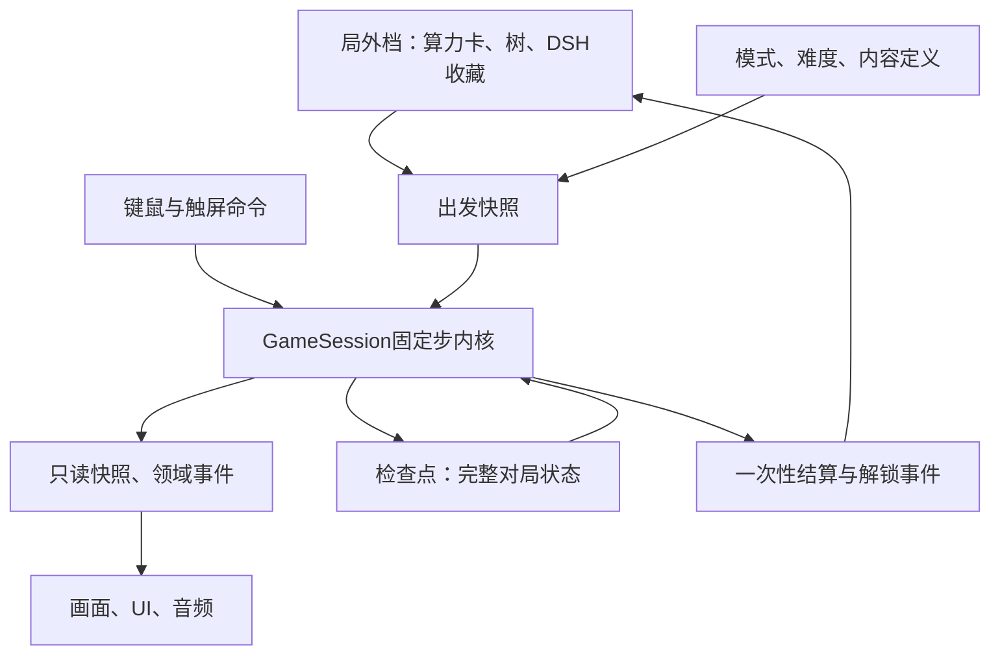

# 06 · Grok实现架构、任务与验收

## 1. 交付约束与现状

本目录定义完整设计与实现任务。用户已授权Codex先编码，后由Grok接续。src/v2已有60个核心函数、110项新测试，剩余239个函数保持TODO；实现状态见13，接口/依赖见11/12。Session、完整内容与表现入口尚待实现，旧游戏入口仍独立，不能视作V2可玩版本。设计数字是可调初值，调参要有记录，不改成另一种玩法。

现有基线仍可玩，保留独立旧版入口。旧源码有可复用的绘图、音效与纯函数，但V2不沿用全部玩法假设：旧counterMult标签倍率、4章×5波、旧角色选择、露水/深化等都不直接迁入。

当前npm test为36文件500项通过，含旧版390项和V2新110项；npm run check:v2通过。旧版build通过。新测试覆盖13所列规则与纯逻辑集成，V2仍无浏览器试玩或平衡数据。

## 2. 系统边界



实现沿用Phaser/Vite，先不更换框架。核心不import Phaser/DOM/浏览器存储，不使用Phaser精灵data作为唯一血量/掉落/插件状态。输入和画面都通过适配层访问核心。不要为这个游戏开发通用Agent执行端或真正MCP/DSH网络接入；这些词在这里是玩法概念。

建议目录：

```text
src/v2/
  core/
    session.js           # 唯一对局状态、tick与命令入口
    flow.js              # 小窝/战斗/插件/暂停/结算流程
    combat/              # 移动、投射物、碰撞、伤害、状态、死亡
    progression/         # 大白饭、等级、插件候选与替换
    plugins/             # 有限效果处理器、蒸馏、5h账本
    world/               # 地图、任务、追兵、首领
    checkpoint.js        # 可序列化快照、校验与恢复
    settlement.js        # 资源、成就与解锁事务
  content/
    weapons.js skills.js companions.js modelProfiles.js collisionProfiles.js
    plugins.js dsh.js tree.js enemies.js bosses.js
    modes.js difficulties.js difficultyMechanics.js maps.js
  adapters/
    input/               # 键鼠/双摇杆，统一命令
    phaser/              # 相机、精灵、地形、粒子
    ui/                  # 小窝、插件选择、HUD、存档提示
    audio.js storage.js
  bootstrap.js
```

本次架构骨架已选定核心保存位置/速度并执行圆形/扇形/高速扫掠碰撞，Phaser只表现（详见11）。不要再同时开启Arcade战斗物理；若未来改变这一决策，必须先改类型/调用契约和验证方案，不能由具体处理器自行选择。

## 3. 内容和状态契约

以下是结构约定，不是可直接运行的完整代码。ID全部使用02–07指定值；显示名可本地化，不能用于逻辑关联。

```ts
type PluginOrigin = 'run' | 'difficulty';
type DamageSourceKind = 'weapon_primary' | 'weapon_secondary' |
  'skill' | 'plugin_secondary' | 'companion' | 'distilled' | 'dsh' | 'enemy';

type Profile = {
  schemaVersion: number;
  gpuCards: number; gpuFragments: number; parts: number;
  purchasedTree: string[];
  discovered: string[]; unlockedWeapons: string[]; unlockedSkills: string[];
  unlockedCompanions: string[]; unlockedDsh: string[];
  equippedDsh: {id: string; options: Record<string, string>}[];
  highestDifficulty: number; apiUnlocked: boolean;
  discoveryLedger: string[]; unlockLedger: string[]; settlementLedger: string[];
  checkpoint: Checkpoint | null;
};

type Session = {
  runId: string; coreVersion: string; contentVersion: string;
  mode: 'tutorial' | 'short' | 'expedition' | 'api'; difficulty: number | 'api';
  seed: number; rngStates: Record<string, number>; tick: number;
  startSnapshot: {tree: string[]; dsh: unknown[]; loadout: unknown; mechanicIds: string[]};
  mechanismRuntime: {activeEvents: unknown[]; pendingEvents: unknown[]; encounterBudgets: unknown[];};
  apiRuntime?: {elapsedTicks: number; bossIndex: number; materialMinute: number; fragmentsThisMinute: number; partsThisMinute: number};
  phase: 'preparing' | 'exploring' | 'boss' | 'pluginChoice' |
    'paused' | 'loraTraining' | 'victory' | 'defeat' | 'withdrawal';
  player: unknown; world: unknown; encounter: unknown;
  level: number; xpRemainder: number; totalTokens: number;
  plugins: {id: string; rank: 1 | 2; origin: PluginOrigin}[];
  pluginRuntime: Record<string, unknown>;
  dshRuntime: Record<string, unknown>; // 含28秒开奖与武器临时更新
  loraRuntime?: {pendingLevels: number[]; trialId: string | null; targetStat: string | null; uiTick: number; resolved: boolean; modifiers: unknown; penalties: unknown;};
  pendingChoices: unknown[]; rerollsRemaining: number;
  distill: Record<'claude' | 'gpt' | 'grok', {stage: number; samples: number}>;
  damageBudgets: Record<string, {tick: number; spent: number}[]>;
  runInventory: {gpuFragments: number; parts: number};
  objectives: unknown[]; discoveries: string[]; eventQueue: unknown[];
};

type DamageRequest = {
  sourceId: string; creditOwner: 'player' | 'enemy'; sourceKind: DamageSourceKind;
  attackId: string; projectileId?: string; targetId: string;
  baseDamage: number; generation: number; chainId: string;
};
```

实际类型应展开unknown字段，不把上述省略字段照抄进生产逻辑。普通插件最多6个`origin=run`；Pro附带5h是额外一个difficulty来源；同id只一条状态，无论origin如何。DSH是另一个集合，不在plugins里混算。只有已解锁/已实现的内容可加入牌池，缺处理器不能静默吞效果。

内容记录至少包括id、displayName、descriptionParams、unlockCondition、effects、stackingPolicy、tags（只作检索）、version。启动校验重复id、未知前置、不可达技能树、缺效果处理器、缺阵营、缺sourceId继承规则、负数伤害/冷却、插件2级缺参数。技能树全树27节点160点；局内插件30种；DSH10项设计（含已确认28秒更新/重置与LoRA微调）；MCP6把；主动8个；伙伴6位；普通敌人9类按GPT7/Claude1/Grok1分配。

### 难度机制契约

为07全部16项建立DifficultyMechanic记录（11级同时有目标信号与Glasswing）：`id`、`unlockAt`、`scope`（常驻AI/地图/目标/事件/Boss）、`appliesTo`、`prerequisites`、`exclusions`、`handlerId`与`contentVersion`。正式数字难度只计算一次`mechanics.filter(m => m.unlockAt <= d)`；API用d=15，Free走独立教程配置。不能用`unlockAt === d`只启用本级，也不能按Pro/Max档覆盖前一档机制集合。

所有AI、地图、目标与Boss读同一组startSnapshot.mechanicIds；Pro附带5h独立使用difficultyPerks，不写入累计表。启动校验机制id唯一、unlockAt恰覆盖1–15、前置在同级或更低级、处理器存在。检查点保存完整机制集/内容版本、压力事件已启动/待触发状态、预警计时、预算分配、箱子/掩体/信号装置/通道状态与随机流；恢复不能重新抽机制、重复增援或刷新警报箱奖励。

07调度器先做适用条件/安全/预算判断，再提交事件；常驻已解锁AI不能因事件轮换被移除。最多2项压力事件的名额在事件结束或取消时释放，不能因插件面板暂停而重新分配。API继承全部机制，只轮换额外事件，不轮换核心解锁集；每个合法API调度周期用同一可复现的事件随机流。

## 4. 时间、事件、伤害和控制

### 固定tick

60tick/秒，渲染帧累积时间。每帧最多执行8步，保留积压；持续积压超过1秒自动性能暂停，用户继续时清理墙钟积压但不快进游戏tick，显示性能提示。后台自动暂停；恢复等待确认，并重置墙钟基准。正常30/60/120渲染FPS下同输入tick得到同结果。

LoRA训练期间暂停世界tick，用独立UI固定时钟驱动指针，后台/用户暂停同时暂停UI时钟；判定只提交一次，恢复后才走负面计时。战斗对象寿命、射速、控制、5h滚动窗口、蒸馏、伙伴、追兵、DSH28秒开奖、Boss读条使用世界tick；不使用表现tween或wall clock执行战斗事件。菜单装饰动画可以独立运行。

单tick：输入命令→合法性/流程→计时/状态→移动AI→攻击生成→扫掠碰撞→排序后的伤害/控制→死亡→奖励/解锁→升级选择队列→目标完成→提交实体增删→事件与快照。命令按seq，碰撞按攻击/目标id稳定排序。玩家和最终首领同tick致死时明确判失败，但首领真实死亡的永久DSH解锁仍按击败事实记一次；不发最终胜利资源。

### 伤害管线

命中合法性、闪避/无敌→5h防御前额度→护甲→安全对齐等减伤→暴击（仅对敌基础武器且具备暴击标记）→护盾→生命→受伤/死亡事件。敌人请求不能使用玩家暴击加成；输出加成在生成攻击基础值与管线之间只应用一次，最终实现要用明确字段标记已应用的层。

不同来源护盾各自有上限/到期tick，消耗顺序按最早到期、相同到期按生成seq。护盾完全吸收不算生命受伤；5h已在护盾前消耗额度。伤害与控制是分离请求：零伤害不自动吞控制；控制检查独立的闪避/控制免疫和解控优先级。

实体首次进入dying后立即不可再次结算，死亡事件携带rewardPolicy、distillEligible、阵营与creditOwner。递归效果用队列，不让kill→explode→kill直接函数递归。次级伤害默认不触发基础武器命中插件；每chain最多4代，每tick最多128个派生效果，超预算停止派生并记录诊断，不能静默把伤害算两次。

### 控制优先级

控制请求先按08唯一应用Glasswing倍数，再叠玩家抵抗，不复制控制实体；禁锢先检查闪避/2秒控制免疫→技能树紧急重试→故障转移→伙伴补丁→施加控制等待玩家解控/挣脱。封禁先检查是否存在合法技能/伙伴目标→DSH白名单→插件越狱→施加封禁。先挡成功的效果消费自己的次数/冷却，后续拦截器不消费。封禁解除不会重新初始化伙伴或补满技能冷却。

## 5. 检查点、随机流、重置与结算

计划/奖励/战斗/表现四条随机流独立；只有表现流可不进入战斗存档。核心不调用Math.random；保存随机状态而非函数闭包。给定同版本、seed、出发快照与命令序列，核心状态摘要必须相同；跨版本回放不预先承诺兼容。

检查点格式含schemaVersion、coreVersion、contentVersion、完整Session、完整性摘要与保存序号。校验成功后构造新Session，不能在旧Session上覆盖几个字段；先释放旧输入/音效/实体订阅，再加载。插件面板正在处理时不写新检查点；安全检查点要求无战斗威胁，避免保存半帧碰撞或未提交事件。

保存用一个局外record原子替换（IndexedDB事务或localStorage单键版本化记录）。读取失败不覆盖原数据，提示不能恢复并保留导出/重试机会；不要无声开新局。正式发布需要明确版本迁移，开发预览可标“此版本不兼容旧检查点”并让用户选择是否新开。

ChatGPT重置调用Boss局部reset事件，不调用检查点load。重置节点、额度与已结算rewardId均不恢复。每次死亡/箱子/目标奖励有稳定id，重放与重复UI操作不可重复发资源。

结算与DSH/彩蛋解锁分别按02/07规则持久化；即时永久发现不丢，当前局出发快照不因为新发现而改变。胜负提交只一次，资源与检查点失效同事务。用户连续点击、刷新、重进菜单都不能加第二次。

## 6. 图像、音频与移动端交付

用户已明确09拿铁盆像素大肥鱼，原图与GPT Pets截图已在设计讨论中查看，文字要求见09（仓库未包含原图）。不得继续用椭圆蓝鱼或统一小工人换色当最终形象；现有绘图只可作明确标记的临时资源。Claude同棕蟹轮廓下做08模型外壳/弱点，GPT七种轮廓与四档模型分离，Grok Bot与低矮穿障表现清楚。详细像素规格和梗名映射以09为准。

《Let Me Go》需要实际音源路径/版本、循环点、音量开关和用户手势播放处理。当前仓库的合成曲不是指定歌曲，不得标为“已接入原曲”。拿不到音源时记录待提供的具体文件，不凭空编曲替代并宣布完成。音频缺失不阻塞核心机制测试，但阻塞“音乐完成”的验收项。

移动端横屏双摇杆、技能/闪避/挣脱/交互按钮、safe-area、安全暂停、长按与多指并行分别验证。触屏抬起、pointercancel、切后台必须清理输入，不能卡住持续移动/射击。菜单文本最小字号14px，关键按钮触控区域至少44×44 CSS像素；三/四张插件在窄屏可横滑选择，战斗暂停，不能把整张卡缩到不可读。

## 7. 实现任务与依赖

| 任务 | 依赖 | Grok交付内容 | 验收门槛 |
|---|---|---|---|
| T00 规格落表 | 无 | 内容schema、稳定id、确认未决资源、旧版基线 | 数量/引用/花费校验过；明确资源占位 |
| T01 核心与输入 | T00 | 单一Session、固定tick、移动/瞄准/射击/冲刺、双摇杆 | 不同渲染帧率结果一致，暂停与后台不走时钟 |
| T02 一张连续地图 | T01 | 相机、遮挡、驻守/追兵、资源/大白饭、拾取 | 出生不贴脸，掉落不丢，探索能环回 |
| T03 等级与插件基础 | T02 | XP、指定级三选一/DSH分支预览首轮四选一、槽位、重抽、初始6个插件 | 升级队列、满槽替换、候选存档/去重正确 |
| T04 蒸馏与5h | T03 | 三来源样本、护甲/追击泡/Bot虚影、滚动额度、Pro附带origin | 有可见来源反馈、边界/恢复不重复生效 |
| T05 单局闭环 | T04 | Claude简版完整Boss、探索目标、胜负、检查点 | 真实可玩，退出恢复相同；不是只跑自动测试 |
| T06 局外成长 | T05 | 算力卡/碎片/零件、27节点、小窝、DSH10种与槽位 | 收入/退款/装配/奖励去重正确 |
| T07 全装备构筑 | T06 | 6MCP、8主动、6伙伴、30局内插件及升级/联动 | 每个效果真实可触发，不能只写卡面 |
| T08 三阵营 | T07 | 7种GPT Pet、单种强Claude蟹、单种Grok人海与简化Boss | 05各破解路径、所有奖励排除规则成立 |
| T09 模式与难度 | T08 | Free、短途、远征、0–15累计机制/Glasswing、四档模型、Grok穿障、API完整继承 | 1–15逐级新增且前缀继承，事件/数值/福利分开，API不因Boss死结束 |
| T10 美术与音乐 | 可与T02后交错 | 确认形象、反馈、指定音乐、界面 | 正确资源可见/可听，音源缺失明确标未完成 |
| T11 完整试玩 | T09、T10 | 桌面/手机真人报告、性能与平衡、回归 | 有录像/记录与缺陷修复，不以旧390测试替代 |

T03首批6插件建议：并行调用、批量处理、大白饭回收、蒸馏、5h限制、故障转移。首片装备只泡泡/扇面两MCP、断开连接/缓存护盾两技能、饭团一伙伴。T05是第一段可评审成果；只能称试作，不声称全系统已完成。之后补齐完整目录，不用新增内容掩盖核心体验问题。

每个任务独立PR，描述实际完成内容/测试/限制；不把设计文件中的所有条目自动勾为完成。不擅自合并或部署，按仓库协作流程交付用户评审。

## 8. 必测场景

### 自动化正确性

1. 普通怪死亡只掉一次大白饭/资源；派生伤害、同时命中、回旋去回都不能重复死亡。
2. 经验溢出、连续升级、多个插件节点、死亡/胜利同帧弹窗顺序正确；未选完不刷怪。
3. 30种插件每种1/2级都至少一条正例与一条边界例；无目标/不兼容武器不能静默变无效奖励。
4. 蒸馏三来源样本、升2级转换、3阶封顶、移除重装、伙伴击杀、回响排除、存档恢复。
5. 5h的t=10秒边界、多个敌人、多发Boss火箭同source、护盾、免疫、插件升级、Pro不占槽、暂停、Boss重置和恢复。
6. 解控/封禁优先级、Space长按不冒充多次keydown、手机辅助挣脱、空伙伴槽、技能已封禁时不能施放。
7. ChatGPT三节点打断/成功/暴力击杀路径、source不换、回响无收益、无全局回档；Grok召唤样本每次最多3。
8. 检查点不回血、不重抽、不刷新箱子/5h/DSH火箭；未过检查点退出回旧档；终局后旧档失效。
9. 资源失败40/50%向下取整、碎片余数、免费重置27节点退款、DSH槽条件、解锁无槽可收藏、重复奖励幂等。
10. Free固定奖励只一次、1→15→API调用解锁、Pro5→Max5x6默认5h变化、较高难度实际击败成就。
11. 相同命令tick与seed重放状态摘要一致；30/60/120FPS模拟与输入一致；后台/性能暂停明确。
12. 存档损坏、版本不兼容、storage写失败、重复结算/双击/刷新，不丢原档、不重复加货币。
13. API长局：Boss死后继续刷怪、等级超过30、31级后插件节点、检查点保留精确时间强度、主动返回/失败比例、无重复首领奖励与材料分钟上限。

14. 逐级机制：1–15的集合严格单调包含且各级新增对应id，11级同时新增两个（目标信号/Glasswing），全表16个id，d=3/6/10/12/15逐项核对；API集合与15级相等。Free不继承正式机制或教程奖励。
15. 行为集：12级GPT既有支援也有换位且可四职能编组；15级Claude Opus可破掩体且保留组合/Glasswing规定控制上限；高难度Grok仍无高级小怪技能。Pro5→6只取消福利，已解锁敌人/地图机制不能丢。
16. 调度：最多两项压力事件、Boss/检查点优先、增援去重/预算不复制、无合法位置则延期/取消、通道始终可达；暂停/读档不刷新事件和箱子奖励。

17. DSH28秒开奖：两结果均可复现，临时品质不叠不永久化，最高品质+20%，换枪/封禁/暂停/恢复正确，重置不触发施放事件或清5h/插件内置冷却。
18. LoRA：每次实际升级一次，连升顺序，固定速率与完美区左右边界、2秒超时、键盘repeat/双触点、暂停/后台、四属性上下限、两类负面恢复后计时、API长局封顶、trialId幂等。
19. Claude四阶段壳/弱点/破壳眩晕覆盖与Grok穿障碰撞矩阵；GPT7×4模型组合的技能覆盖/继承；11级Glasswing与解控/封禁防护只处理一次。
20. 09像素参考与梗名改名：稳定id、原伤害/冷却不变，拿铁盆不自动变格挡/近战，移动端与LoRA/挣脱Space输入不串。

### 真人体验（不能用机器人代替）

- 未读文档的玩家在Free学会射击、大白饭、插件、挣脱、检查点；能说出一次插件改变了什么。
- 短途有效时长落在10–15分钟附近；远征有足够探索/成长达到40+，不靠空跑或堆血。
- 三阵营能按外观和行为分辨；Claude数量少数值高，GPT有截图七种Pets机制，Grok普通Bot仅近身人海。API不能因Boss死亡结束，也不能靠暂停/检查点跳过时间强度。
- 至少两种组合成型后明显横扫普通遭遇；没有全局标签检查或实时敌人补强抵消收益。
- 桌面与一台明确型号手机均实玩完整局，记录帧时间、活实体峰值、误触与可读性；低帧率不能提高敌人相对射速。

## 9. 仍需输入与允许调参的范围

实际资源：拿铁盆像素大肥鱼与GPT七种Pets用户参考已在设计讨论中提供，09记录文件名和造型要求，原图未上传仓库；最终精灵仍待制作，Claude棕蟹/Grok Bot细节可继续补充参考。指定《Let Me Go》音源仍待提供，不擅自用合成曲替代。

本规格给出的默认解释：5/10归前一档、Pro自带5h采用既有防御效果且不占普通槽。另补齐的默认初值包括11级Glasswing（时长/禁锢挣脱×2）、LoRA仪表盘区间/负面参数与解锁条件、四档模型数值；这些在PR描述醒目列出，用户若更正应全目录同步。

可按试玩调整：经验数量/敌人血量/插件倍率/花费/掉率/地图大小/冷却。不得静默改变：唯一主角、双端手动瞄准、两种时长目标、社区概念映射、DSH解锁/槽位关系、检查点无额外效果、Boss核心机制、指定音乐。
