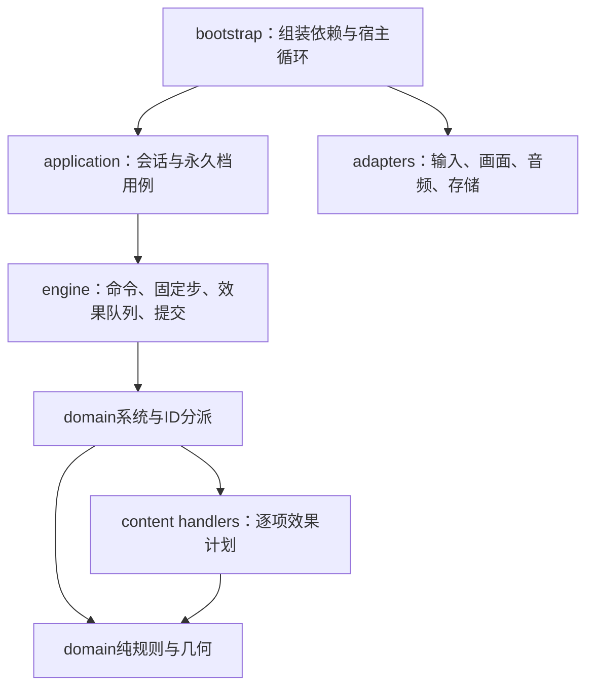

# 11 · V2架构骨架、状态权限与调用规则

状态：**独立战斗试作v2.html已可操作，完整冒险仍未完成**。用户已授权先由Codex编码。197个函数有实现，136个显式TODO；带core-preview标记的实现仅覆盖当前试作。实际范围见[开发进度](13-development-status.md)。旧src/main.js保持独立。

入口文档：[全部函数目录](12-function-catalog.md)；入口源码：[bootstrap.js](../../src/v2/bootstrap.js)；类型契约：[contracts.d.ts](../../src/v2/contracts.d.ts)；机器可读依赖与绑定：[architecture-manifest.json](../../src/v2/architecture-manifest.json)。函数目录和manifest列出全部跨模块接口以及逐内容处理器，Grok填写函数体时应保留接口/约束，新增公共函数要同步契约。

## 1. 已做出的架构选择

- 沿用Phaser/Vite作为表现和构建基础，**战斗位置、扫掠碰撞、伤害、控制和时间由独立核心负责**，Phaser不再运行另一套战斗物理。06原有的两方案讨论在本次骨架中收敛为这一条。
- 单局私有状态由`engine/session`持有；外部只拿句柄、深只读状态快照或显示DTO。当前生命唯一存于玩家对应的`world.entities[player.entityId].hp`，不在PlayerState复制一份会漂移的生命。
- 系统函数只读输入并产出`SystemPlan`，由`engine/reducer`应用到tick私有工作副本；完整tick通过不变量校验后再提交一个revision。表现/音频/存储回调不能写实体。
- 插件/DSH/技能/敌人处理器产出效果请求，不直接调用伤害函数、Session提交或存档。战斗队列处理派生效果，替代直接递归。
- Profile（永久余额/树/DSH/发现/活动checkpoint）由应用层串行处理并通过StoragePort原子CAS保存。核心tick绝不等待I/O，不拆成“先加钱、后删存档”两次磁盘写入。
- 世界与LoRA UI有独立固定时钟/命令域。暂停/后台都不走；LoRA时世界冻结而UI指针继续，按输入发生的逻辑UI tick判定，不用渲染帧数判定。

## 2. 模块依赖方向

精确直接依赖以manifest各module.dependencies和实际import为准，必须是有向无环图。领域系统可经dispatch读取对应内容处理器，处理器只能依赖下层纯规则，不能反向依赖系统调度器。

禁止：domain/content-handler→engine/application/adapters；engine→application/adapters；application→具体adapter模块；存储→核心提交；UI→伤害/奖励/写档。适配器只做端口实现，application通过注入接口调用，不反向import具体实现。JSON manifest是架构元数据，不是让所有函数自动执行的脚本。

## 3. 上下游调用如何阅读

当前共89个JS模块、312个具名函数，类型与manifest另列。每个函数都有：具名参数和类型、返回类型、功能描述、阶段、状态权限、允许调用的下游、特殊约束。源码JSDoc的`@calls`与manifest、12目录对应。

- `sequence`：声明阶段依赖与先后，但需要相应合法性/phase/目标存在等条件。不能把列出的函数不带参数、无条件全部调用。
- `dispatch`：列出可能分支，按type或稳定id只调用一个对应分支；例如一次MCP射击不能把六把武器处理器全跑。
- 同模块私有数学/绘制辅助函数可在实现时添加，不能因此绕过公共状态权限；新增跨模块依赖/函数必须更新manifest与目录并重新查环。
- 错误使用`Result<T>`或`ValidationReport`返回可解释原因。占位阶段唯一的异常是TODO错误；填完后不能把未实现处理器伪装成成功。

## 4. 创建/继续/销毁的调用规则

### 创建新局

`bootstrapV2`：加载目录→建立处理器注册表→校验→建立存储/输入/表现/音频适配器→包装端口→读取Profile→`createApplication`。所有内容处理器完成前不得把占位bootstrap接入旧游戏。

`startAdventure`：`validateStartRequest`→`resolveDifficultySnapshot`→锁定树/DSH/配装/模型/累计机制→`createGameSession`。未确认覆盖活动检查点时拒绝新开。Profile之后改变不影响此局快照。

### 继续对局

`continueAdventure`：repository读取→校验checkpoint→停掉旧会话输入消费和表现订阅→`restoreGameSession`新建暂停会话→清持有输入→发布显示投影→玩家确认继续。不能在旧世界上逐字段覆盖，不重抽候选/LoRA/开奖，不把暂停时间算成冷却恢复。

### 结束与销毁

普通终局或API撤回请求通过`settleAdventure`生成唯一结算，并与checkpoint失效同事务保存；失败保留待提交状态，不能提示“已保存”。已提交的runId重复调用返回已处理状态，不重复入账。

`disposeApplication`先确认待保存请求的结果，再释放会话及全部端口；宿主卸载监听后不再发帧。各dispose幂等，旧局回调不能命中新局。

## 5. 一个宿主帧与一个世界tick

宿主帧：读取当前显示世界tick/UI tick/phase→采样输入→`mapInputTimestampToTick`按世界/UI域映射→排命令→`advanceApplicationFrame`→读取本帧一次事件批次→画面和音频消费同一批→tick之外安排串行持久化。适配器的tween/音频结束回调不得推进战斗。

`advanceApplicationFrame`经`scheduleFrame`决定执行世界步或UI步，世界60Hz、每帧最多8步；持续积压超过1秒性能暂停。每个命令带clock域/targetTick/seq/id，世界tick被冻结时仍能处理暂停/继续和LoRA命令；command.clock决定targetTick属于哪一域，不能用冻结的worldTick判定训练时机。

### 世界顺序（权威）

1. 按world域筛选命令、排序和幂等校验，逐个产计划并应用。命令若转为暂停/训练/选择/终态，立即停止本tick后续战斗阶段，只提交该合法转移；不先刷一批怪。
2. 更新合法世界计时、状态与到期；在相应Tick事件上处理28秒DSH和其他定时钩子。对同eventId只分派一次。
3. 安排/推进压力事件与刷怪，按预算和合法点提交实体；当场应用后的新实体可被本tick后续系统读取，不重复出生。
4. 规划普通敌人/模型/累计常驻机制、Boss、伙伴意图与预警，解析控制/冷却限制。
5. 规划玩家移动/实体运动/武器开火/大白饭运动，保存扫掠起终点；技能命令只在步骤1成功施放一次，不能此处再施放。
6. 碰撞只产生请求→`drainEffectQueue`有界执行伤害/控制/治疗/护盾/拾取；每次应用到私有工作状态，先标dying再发死亡钩子，再将子效果排队。
7. 接纳效果循环返回的`nextWorking`和死亡/事件输出，**不能把已应用计划再apply一遍**。按唯一死亡记录规划奖励/样本/解锁，再处理地图探索、目标、API阶段和经验升级队列。
8. 先判终局：玩家与最终Boss同tick死亡判失败；API Boss死亡仅阶段事件。终局清理未展示的升级交互，不发最终胜利资源；真实Boss死亡的永久解锁仍保留。
9. 无终局时逐级处理成长面板。校验全部状态不变量→`commitWorkingState`仅一次revision→发布只读投影、领域事件与持久化意图。

12中的下游列表表示这条流水线用到的函数；同一函数可在多个子阶段使用，例如`applySystemPlan`不是只能调用一次。每次读取context都指向最新私有工作状态，不许全程沿用帧开头旧状态。

### 效果循环

请求带chainId/generation/sourceId/attackId。按稳定顺序处理，代数≤4，每tick派生≤128。次级攻击不冒充原生武器命中；已dying者不再结算。超预算记录诊断并停止该次派生，不新建chainId绕限制。不用事件订阅器直接递归调用`resolveDamageRequest`。

## 6. LoRA与升级的调用顺序

经验变化→`planLevelProgression`建立LevelReward队列→本级正常生命收益→有DSH时`createLoraTrial`→进入loraTraining→UI步推进指针→确认/超时→`planLoraOutcome`只提交一次→本级若有插件再`createPluginChoice`→下一级。只有完成整批才恢复世界。

LoRA临时负面从世界恢复后才消耗，同类刷新、两类可并存；UI每次重新渲染不能重新生成trial、目标属性或完美区域。Space在LoRA域只作用训练，在控制域只作用挣脱，不向另一系统透传。28秒开奖由世界时钟驱动，训练中不开奖。

## 7. 伤害、外壳、控制与重置

伤害唯一入口`resolveDamageRequest`：合法性/去重/保护→有外壳目标分流弱点与壳→敌对玩家的5h额度→护甲/减伤/允许的暴击→护盾→生命/事件。跳过外壳的分支不允许任何插件/伙伴自行扣本体；壳溢出不穿本体。额度在护盾前记账，但闪避/无敌否决不记账。

`resolveControlRequest`唯一应用Glasswing，再处理玩家修饰/拦截；`planMechanic11Glasswing`仅声明资格，不再乘一次。禁锢拦截按树→故障转移→补丁；封禁按白名单→越狱。只消费先挡成功的一份。伤害0不自动等于控制免疫。

ChatGPT重置只走`planGptReset`，绝不能调用checkpoint恢复或创建新Session；sourceId/5h/玩家资源和状态不变，重置回响无奖励/样本。DSH重置只走`planCooldownReset`，不能把它当技能施放或刷新插件次数。

## 8. 三个宿主端口及存储端口

| 接口方法 | 具体适配器占位实现/包装 | 允许调用者 |
|---|---|---|
| InputPort.poll/suspend/dispose | createInputPort→pollInputSamples/clearHeldInput/disposeInputAdapter | bootstrap/application生命周期 |
| PresentationPort.render/present/dispose | createPresentationPort→renderPresentation/presentDomainEvents/disposePresentationAdapter | 宿主帧和应用生命周期 |
| AudioPort.unlock/play/suspend/dispose | createAudioPort→unlockAudio/playAudioEvents/suspendAudio/disposeAudioAdapter | 用户手势、帧输出与生命周期 |
| StoragePort.read | createStoragePort→readStorageRecord | application/repository |
| StoragePort.compareAndSwap | createStoragePort→compareAndSwapStorageRecord | application/repository串行提交 |

端口方法是动态注入边，因而不产生application对具体adapter的import。manifest记录静态函数调用，表中补足动态边。`onUiAction`接收表现回传的用例请求，经dispatchApplicationAction调用开局/保存/结算等对应分支；实际战斗命令只进队列。`onBrowserFrame`持有BrowserRuntime宿主句柄；核心只持GameSession不持DOM/音频/存储。

## 9. 内容覆盖与实施边界

本次95项内容绑定：逐项覆盖30插件、10DSH、6MCP、8技能、6伙伴、9普通敌人、Claude5/GPT4/Grok1共10模型profile、16累计机制。树27节点与6设施是声明式数据定义，分别由树/设施用例处理，**不为每个加一护甲的节点造一套独立业务函数**。其dataDefinitions同样列在manifest，绑定不存在必须阻止启动。

全部公开函数签名、类型、功能/权限、上下游关系已落文件，逐函数实现状态见12及manifest。后续编码保留明确TODO，不能用空return冒充完成。当前已验证核心规则及纯逻辑集成，尚未验证完整V2玩法与表现。

## 10. 当前验证与实现修正

- 89个JS模块、333个公开函数：197有实现、136显式TODO。95项处理器绑定与33项声明式数据消费者仍为设计覆盖数量，不能等同于已实现内容数量。
- `npm run check:v2`执行TypeScript 5.9.3 strict/checkJs及AST审计：实际导出、参数、import、函数状态、已实现函数的公开调用边、剩余TODO异常、模块/函数DAG与内容绑定。
- `npm test`：44文件638项通过，其中V2共248项；双入口构建通过。Chromium桌面/手机触控仿真43项，另12项短途、23项模组、16项小窝与14项换装检查通过，尚无真人完整冒险验收。

当前实现对原占位契约做了必要补全，详见13：

1. ClockState带当前world/UI域，切换模式时不把余下的世界时间用于训练。
2. GameState带有到期时间的attackHits；DamageRequest必须提供expiresAt。发射端使用不可复用的攻击ID；同一目标可分别受击的多弹/回旋去回/爆炸阶段需分配不同的攻击ID，并共享chainId进行派生预算管理。
3. GameState.lastWorldAdvanceTick与DshCycleState.lastAdvancedTick使世界计时/10秒开奖计时每tick至多推进一次；保存时完整保留。
4. `createLoraTrial`返回LoraTrialCreation（trial、nextRandom），调用者同一计划提交二者，不能只选目标而丢掉随机游标。
5. `commitWorkingState(previous, working, catalog, outbox)`增加显式目录与outbox参数。Reducer只应用changes，不自动把plan.effects/events/persistence写回状态；tick编排器负责效果队列与outbox，最终只提交一次。提交器重新编号事件seq，拒绝重复事件、跨局或错误时钟域提交。
6. domain/stateValidation复用状态校验，避免检查点反向import engine；序列化/版本常量同样是实际依赖。

恢复低层检查点只构造新状态，设为paused并记录resumePhase；没有推进时间或授予生命/资源。`createCheckpoint`是编码器，应用入口必须先通过canCreateCheckpoint；Free使用独立localStorage调试槽；正式冒险的Profile/StoragePort通过CAS原子保存、结算和删档。

## 11. 当前战斗试作的调用入口

`v2.html → src/v2-preview.js → preview/host.mountCombatPreview`组装试作宿主；host只持Session句柄、输入与表现，不修改旧main。`createGameSession`接受显式core-preview/Free及adventure-slice的短途/远征1–15、API，通用full bootstrap仍拒绝。世界/UI统一进入正式`engine/tick`，previewTick仅作兼容委托；当前Canvas2D表现和preview/host不冒充未实现的Phaser/通用宿主适配器。

世界：enqueue命令→Session筛出到期命令→tick推进→计时/出生/AI/移动/开火/扫掠/拾取→有界效果队列逐次伤害与死亡→唯一奖励→远征首领推进→玩家优先的终局判定→API继续/撤回与目标→成长/LoRA/插件面板→维护→校验与commit一次。UI暂停/继续只消费UI命令，不推进冻结的世界钟；恢复清空墙钟积压。插件候选与随机、LoRA试验与随机必须同一计划提交。

Session私有step/getRecord不导出；AST工具展开它们转达的真实公开依赖。snapshot和公开读取返回副本，Renderer不运行物理。当前范围、原版169定义/95绑定、测试和未完成事项统一见13；逐函数实现范围及调用上下游见12/manifest。

## 远征地区状态增量

`GameState.expedition`只在远征持有seed路线、已击败海域、访问最远海域与三个归档槽，当前地区槽为null。`RegionArchive`保存当地World/Boss/命中与生成时间；玩家/伙伴及其状态/护盾、全局背包/成长/随机和DSH使用标记保留在当前GameState。Map.clockOffset记录离开当地的世界时间。当前地区之外不运行AI/出生/潮流。

`map.planWorldInteraction`只路由Boss/通道/休整意图；`planExpeditionTravel`生成replaceExpeditionWorld计划，Reducer是唯一状态写入者。新地区由独立expeditionMap工厂建立，归档装配器只接受明确地图初始化操作，domain不依赖engine。返程只恢复档案并平移NPC绝对时钟；regionRules提供海域倍率/路线/当地时钟，Boss共享encounterIds保证节点命名关系。归档完整性在domain/stateValidation递归验证，不反向依赖Session。

`ChooseExpeditionRest`是恢复后重新校验安全/距离/未领取的世界命令；面板本身不授予收益。独立休整、通道和检查点分别处理，后二者不修改生命/冷却。Boss奖励在终局前提交计划，结算累计击败数包含归档海域。更多精确调用规则和本轮验证见13。

## 小窝与社区MCP增量

`application/nest.executeNestAction`是小窝消费入口：读取最新档案→拒绝活动检查点→纯领域计划→CAS；冲突重读重算，最多3次。`prepareAdventureStart`验证拥有/能力后复制树与DSH，Session不再读取局外档。体魄只在初始化应用一次；MCP专属输出、换枪触发、伤害保命和无伤CD由各自明确消费者处理，检查点保留全部已用标记/时钟。

社区MCP使用`ContentCatalog.modWeapons`明确注册原生行为模板与所属包；`resolveWeaponTemplate`验证包锁后才分派原生处理器，不把社区ID伪装成95项原版绑定之一。新武器仍走相同命中/额度/暴击/伤害链。SDK1.1仅Free开放，正式Profile继续原版目录。

## 弹体与装备实例增量

`createWeaponProjectile`统一建立原生/并行次级弹的行为快照，`planEntityMotion`推进回旋分段和生命周期，`planCollisionEffects`处理碰撞、一次爆破；`setProjectileLeg`仅可变更真实弹体的攻击段。换程不能使本步已有请求失效。所有爆破仍进入原有damage队列，不能直接扣血。

`PickupState.weapon`是可选完整实例；世界与背包不能同时存在同一instanceId。地面武器只经F/EquipPickup原子换装，不能经Collect吸入。宿主满槽预览暂停世界，确认后恢复并排世界命令，领域重新校验距离/槽位；原实例留地并继续保存CD/更新期限。
